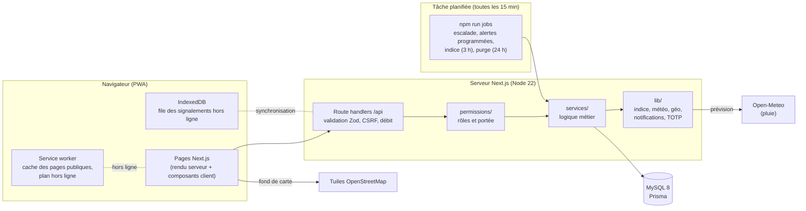
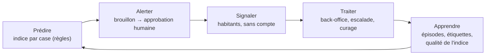
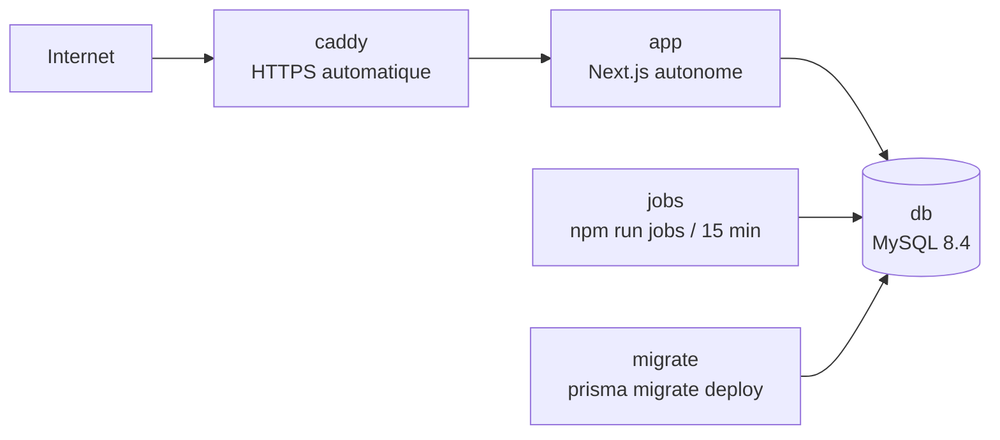

# Architecture – Banlieue Alerte

## Vue d'ensemble

## Boucle du produit

## Organisation du code

| Dossier | Rôle |
|---|---|
| `src/app/` | Pages (App Router) et route handlers `/api` |
| `src/components/` | Interface, sans logique métier, regroupée par fonctionnalité |
| `src/services/` | Logique métier : signalements, back-office, alertes, indice, épisodes, curage, supervision, démonstration |
| `src/lib/risk/` | Indice de risque (code pur, testé) : facteurs, score, évaluation |
| `src/lib/weather/`, `src/lib/geo/` | Météo (Open-Meteo, panne), géographie (rattachement, cases) |
| `src/lib/notifications/` | Couche d'envoi, simulation par défaut |
| `src/lib/auth/` | Sessions, CSRF, mots de passe, TOTP, chiffrement |
| `src/permissions/` | Politiques d'accès pures et filtres de portée |
| `src/validators/` | Schémas Zod (entrées des API) |
| `src/jobs/` | Tâche planifiée unique, purge |
| `src/i18n/` | Textes (français ; wolof après relecture) |
| `prisma/` | Schéma, migrations, données de démonstration, cases SRTM |
| `scripts/` | Exploitation : invitation administrateur, cases, plan hors ligne, sauvegardes |
| `tests/` | Unitaires, intégration (base), parcours Playwright |

## Choix structurants

Les décisions sont numérotées dans `docs/DECISIONS.md`. Les principales :
- D-034 : sessions maison ;
- D-036 : permissions et portée géographique ;
- D-042 : service worker sans aucune page privée en cache ;
- D-046 : grille de l'indice ;
- D-050 : envoi des alertes seulement après approbation ;
- D-054 : protocole d'évaluation ;
- D-057 : tâche planifiée unique ;
- D-064 : second facteur de l'administrateur ;
- D-067 : production Docker.

## Déploiement

Voir `docs/DEPLOIEMENT.md`.
